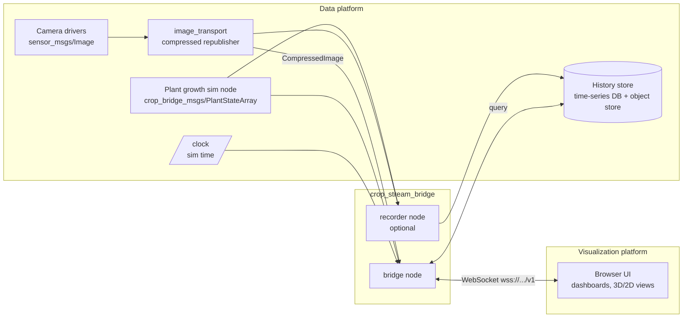
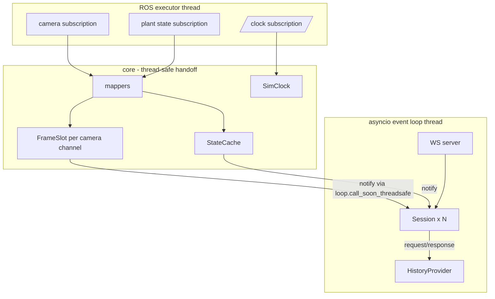

# crop_stream_bridge — Architecture (v0.1, draft for review)

> Status: **design review**. No code yet. Every section ending in an
> **Open question** needs a decision before the matching milestone starts.

## 1. Purpose

Researchers watch a **simulated plant-growth model** and **live crop cameras**
in a web visualization platform. They need to:

1. See the live camera feed(s) of the crop.
2. See the current state of the simulated plants (height, leaf count, LAI,
   biomass, phenological stage, …) as it evolves.
3. Compare **day-to-day changes**: "show plant P-17 on sim-day 12 vs. day 19",
   growth curves over a range of days.

`crop_stream_bridge` is the **only** component that talks to both sides:

- **Data platform side** — the ROS 2 graph (camera drivers, the growth
  simulation node, `/clock`) plus whatever stores history.
- **Visualization platform side** — browsers/services connecting over
  **WebSocket**.

The visualization platform never sees ROS topics, QoS, or message types. It
sees a small, versioned, domain-level protocol (*channels*, *plants*,
*sim days*, *frames*). That decoupling is the main reason this package exists.

## 2. Scope

| In scope | Out of scope |
|---|---|
| Subscribing to configured ROS 2 topics (camera, sim state, clock) | Running the growth simulation itself |
| Serving live frames + state over WS with per-client rate control | The visualization UI (we ship only a tiny reference JS client for testing) |
| Request/response API over the same WS (snapshots, history queries) | Long-term storage engine (we use an adapter to it) |
| Optional recorder that writes daily snapshots to the history store | Camera drivers, image_transport plugins |
| Auth, metrics, health, Docker image | Video transcoding to H.264/WebRTC (future, see §11) |

## 3. Context



## 4. Key design decisions

| # | Decision | Why | Alternatives considered |
|---|---|---|---|
| D1 | **ROS 2** (target Jazzy, also Humble) | ROS 1 is EOL (Noetic, May 2025) | ROS 1 — rejected unless the sim is ROS 1-only (*open question Q1*) |
| D2 | **Python (rclpy) + asyncio** for v1 | Fast to build and review; the heavy lifting (JPEG encode) happens in C++ upstream | C++ (`rclcpp` + Boost.Beast/uWebSockets) — revisit only if profiling shows the bridge is the bottleneck |
| D3 | **Subscribe to `CompressedImage`, forward bytes as-is** | No decode/re-encode in Python ⇒ near-zero CPU per frame. `image_transport` republisher does the encoding | Encode raw `Image` in the bridge with OpenCV — supported as fallback for cameras without a compressed topic |
| D4 | **Custom domain protocol**, not raw topic mirroring | UI must not depend on ROS names/types; we need domain operations (history by sim-day, per-plant queries) | `rosbridge_suite` (JSON + base64 images: ~33% bloat, exposes whole graph); `foxglove_bridge` (efficient binary, but generic topic mirror, no domain API/auth) |
| D5 | **One WS connection, two frame kinds**: JSON text frames for control/state, binary frames for images | Images stay binary (no base64), control stays human-readable and debuggable | All-JSON; all-protobuf/CBOR — possible v2 |
| D6 | **Latest-frame-wins** delivery for camera channels | A slow client must never slow down ROS or other clients; stale frames are worthless for "live" | Queues per client — rejected (unbounded memory / latency growth) |
| D7 | **Sim time is first-class**: every message carries `sim_time`, `sim_day`, and `wall_time` | "Day-to-day" is in *simulation* days, which do not match wall-clock days | Wall time only — rejected |
| D8 | **History behind an adapter interface** | Unknown/varied storage on the data-platform side; keeps the bridge testable | Hard-wire a DB — rejected |
| D9 | **Channel allowlist in YAML config** | Security + stability: clients can only reach what is declared | Dynamic topic discovery — rejected for external clients |

## 5. Package layout

ROS convention: interfaces live in their own package.

```
crop_stream_bridge/                  # colcon workspace src/ subtree (or its own repo)
├── crop_bridge_msgs/                # ament_cmake — interfaces only
│   ├── msg/PlantState.msg
│   ├── msg/PlantStateArray.msg
│   ├── msg/GrowthEvent.msg          # e.g. stage change, harvest, stress event
│   └── srv/GetPlantHistory.srv      # used by the ROS-service history adapter
├── crop_stream_bridge/              # ament_python — the bridge
│   ├── crop_stream_bridge/
│   │   ├── node.py                  # entry point: wires everything, owns threads
│   │   ├── config.py                # YAML → typed config (pydantic/dataclasses), validation
│   │   ├── ros/
│   │   │   ├── ingress.py           # subscriptions per channel, QoS profiles
│   │   │   └── sim_clock.py         # /clock → sim_time, sim_day
│   │   ├── core/
│   │   │   ├── channel.py           # Channel base + CameraChannel, PlantStateChannel, ClockChannel
│   │   │   ├── registry.py          # channel id → Channel, subscriber bookkeeping
│   │   │   ├── frame_slot.py        # latest-value slot with version counter (lock-free handoff)
│   │   │   ├── state_cache.py       # last known state per plant for late joiners
│   │   │   └── mappers.py           # ROS msg → domain DTO (the ONLY place that knows ROS types)
│   │   ├── transport/
│   │   │   ├── ws_server.py         # websockets server, /v1 endpoint, /healthz, /metrics
│   │   │   ├── session.py           # one per client: subscriptions, rate limits, sender tasks
│   │   │   ├── protocol.py          # message schemas, binary header codec, versioning
│   │   │   └── auth.py              # token verification (pluggable)
│   │   ├── history/
│   │   │   ├── base.py              # HistoryProvider protocol (abstract)
│   │   │   ├── ros_service.py       # calls GetPlantHistory on the data platform
│   │   │   ├── sql.py               # TimescaleDB/PostgreSQL implementation
│   │   │   └── memory.py            # in-memory, for tests and demos
│   │   ├── recorder/
│   │   │   └── recorder_node.py     # optional: daily snapshots → history store
│   │   └── observability/
│   │       ├── metrics.py           # Prometheus counters/gauges
│   │       └── diagnostics.py       # diagnostic_msgs publisher
│   ├── config/bridge.example.yaml
│   ├── launch/bridge.launch.py
│   ├── test/                        # pytest: unit (no ROS) + launch_testing (with ROS)
│   └── package.xml / setup.py
├── clients/js/                      # tiny reference client + protocol typings (TS)
├── docker/Dockerfile                # ros:jazzy base
└── docs/ARCHITECTURE.md, PROTOCOL.md
```

Rule: **only `ros/` and `core/mappers.py` import ROS message types.** Everything
under `core/`, `transport/`, `history/` is plain Python and unit-testable
without a ROS installation.

## 6. Runtime architecture

### 6.1 Components



### 6.2 Threading model

- **Thread A — ROS:** `MultiThreadedExecutor` spinning the node. Callbacks do
  the minimum: map message → DTO, write to `FrameSlot`/`StateCache`, then
  `loop.call_soon_threadsafe(channel.notify)`. **No I/O, no awaits, no blocking.**
- **Thread B — asyncio:** WS server, sessions, history queries.
- Handoff is via the `FrameSlot` (single latest value + monotonically
  increasing `seq`, guarded by a tiny lock). Neither side ever waits on the other.

### 6.3 Live frame path (hot path)

1. Camera publishes `CompressedImage` (JPEG) — encoded upstream.
2. Bridge callback stores `(bytes, stamp, seq)` in the channel's `FrameSlot`
   and pings subscribed sessions. Cost: one reference assignment.
3. Each session has **one sender task per subscription**:
   ```
   loop:
     wait until slot.seq > last_sent_seq           # new frame available
     wait until now - last_sent >= 1/max_fps       # per-client rate limit
     if socket write buffer > high_water: drop, count, continue   # backpressure
     send binary frame (header + JPEG bytes)
   ```
4. Frames that arrive while a client is busy are simply overwritten →
   slow clients get lower fps, never higher latency. Dropped frames are
   counted in metrics.

Optional per-subscription transform (`max_width`, `quality`) uses OpenCV
**only when requested**, and the result is cached per (channel, seq, params)
so N clients with the same params cost one transcode.

### 6.4 Plant-state path

- Sim publishes `PlantStateArray` (one message per sim step, all plants).
- `StateCache` keeps the latest `PlantState` per `plant_id`.
- Clients subscribed to `sim/plant_state` receive **deltas** (only plants that
  changed), plus a full snapshot on subscribe (so late joiners are consistent).
- Rate-limited per client (default 2 Hz) — the UI does not need every sim step.

### 6.5 Request/response path

Requests carry a client-chosen `req_id`; the response echoes it. Requests are
handled as independent asyncio tasks, so a slow history query never blocks the
live stream on the same connection. Each request has a timeout (default 10 s).

## 7. Domain model

```text
PlantState
  plant_id        string      # stable id, e.g. "bed2/P-17"
  sim_time        time        # from /clock
  sim_day         uint32      # days after sowing (DAS), computed from sim_time & config.sowing_time
  height_m        float32
  leaf_count      uint16
  leaf_area_m2    float32
  biomass_g       float32
  stage           string      # phenological stage, e.g. "BBCH-31" (enum TBD with model owner)
  extra           KeyValue[]  # model-specific metrics without schema change

GrowthEvent
  plant_id, sim_time, sim_day, type (STAGE_CHANGE | STRESS | HARVEST | ...), detail
```

The exact field list depends on what the growth model actually produces —
**Open question Q2.**

`sim_day` definition: `floor((sim_time - sowing_time) / 86400 s)`. Sowing time
comes from config or from a latched topic published by the sim.

## 8. WebSocket protocol (v1 summary — full spec goes in `PROTOCOL.md`)

Endpoint: `wss://<host>/v1`, subprotocol `cropviz.v1`.

### 8.1 Control & state — JSON text frames

Client → server:

| `op` | Fields | Response |
|---|---|---|
| `hello` | `token`, `client` | `welcome { server_version, protocol: 1, session_id }` |
| `list_channels` | — | `channels [ {id, kind, meta} ]` |
| `subscribe` | `channel`, `max_fps?`, `max_width?`, `quality?` | `subscribed { channel, sub_id }` |
| `unsubscribe` | `sub_id` | `unsubscribed` |
| `get_snapshot` | `channel` | one binary frame + `snapshot_meta` |
| `get_plant_state` | `plant_ids?` | `plant_state { plants[] }` |
| `query_history` | `plant_ids`, `metrics[]`, `from_day`, `to_day`, `resolution` (`step`\|`day`) | `history { series[] }` (paginated with `cursor`) |
| `get_day_images` | `camera`, `days[]` | binary frames tagged with `req_id` (recorded daily snapshots) |
| `ping` | — | `pong` |

All requests: `{ "op": ..., "req_id": "<client id>", ... }`.
All errors: `{ "op": "error", "req_id": ..., "code": "NOT_FOUND|BAD_REQUEST|UNAUTHORIZED|TIMEOUT|INTERNAL", "message": ... }`.

Server → client pushes: `plant_state_delta`, `growth_event`, `sim_clock`
(`sim_time`, `sim_day`, `rate` — e.g. sim running at 1 day/minute),
`channel_status` (camera went stale / came back).

### 8.2 Media — binary frames

Fixed 32-byte little-endian header, then payload. Easy to parse with
`DataView` in the browser.

| Offset | Size | Field |
|---|---|---|
| 0 | 1 | `magic` = 0xC5 |
| 1 | 1 | `version` = 1 |
| 2 | 1 | `kind` (1 = live frame, 2 = snapshot reply, 3 = historical image) |
| 3 | 1 | `encoding` (1 = JPEG, 2 = PNG, 3 = WebP) |
| 4 | 4 | `sub_id` or `req_id` hash |
| 8 | 4 | `seq` |
| 12 | 8 | `stamp_ns` (ROS header stamp, sim time if `use_sim_time`) |
| 20 | 8 | `wall_ns` (bridge receive time — lets UI show end-to-end latency) |
| 28 | 4 | `sim_day` |
| 32 | … | image bytes (directly usable via `new Blob([...], {type:"image/jpeg"})`) |

### 8.3 Versioning

- Breaking changes ⇒ new path `/v2` and subprotocol `cropviz.v2`; v1 kept for
  one release.
- Unknown JSON fields must be ignored by both sides (forward compatibility).

## 9. Configuration (example)

```yaml
server:
  host: 0.0.0.0
  port: 9090
  max_clients: 50
  send_high_water_bytes: 4_000_000     # per-client backpressure threshold
auth:
  mode: static_token                   # none | static_token | jwt
  tokens_file: /run/secrets/bridge_tokens
simulation:
  use_sim_time: true
  sowing_time: "2026-03-01T00:00:00Z"  # or sowing_topic: /crop_sim/sowing_time
channels:
  - id: cam/greenhouse_north
    kind: camera
    topic: /cameras/north/image_raw/compressed
    msg_type: sensor_msgs/msg/CompressedImage
    qos: sensor_data                   # best effort, depth 1
    default_max_fps: 10
    stale_after_s: 3
  - id: sim/plant_state
    kind: plant_state
    topic: /crop_sim/plant_states
    qos: reliable
    default_max_hz: 2
  - id: sim/events
    kind: growth_event
    topic: /crop_sim/events
history:
  provider: sql                        # memory | ros_service | sql
  dsn_env: CROP_HISTORY_DSN
recorder:
  enabled: true
  snapshot_every: sim_day              # or wall clock interval
  cameras: [cam/greenhouse_north]
  image_store: s3://crop-snapshots/    # or local path
```

## 10. Cross-cutting concerns

**Security**
- TLS terminated at a reverse proxy (nginx/Traefik); bridge itself speaks plain WS on a private network.
- Auth on `hello` (token or JWT); unauthenticated sessions are closed after 5 s.
- `Origin` allowlist. Read-only API in v1 — clients cannot publish to ROS.
- Only channels declared in config are reachable (D9).

**Reliability**
- Camera stale detection → `channel_status: stale` pushed to clients.
- Bridge restarts are cheap: no state that isn't recoverable from ROS/history.
- Client reconnect: protocol is stateless apart from subscriptions; reference client re-subscribes automatically.

**Observability**
- `/healthz` (liveness), `/readyz` (ROS ingress receiving data).
- Prometheus `/metrics`: clients connected, frames in/out/dropped per channel, send latency, history query latency, bytes out.
- `diagnostic_msgs/DiagnosticArray` on `/diagnostics` for ROS-side tooling.

**Testing**
- Unit (no ROS): protocol codec, FrameSlot, session rate-limiting/backpressure, mappers with fake messages, history providers.
- Integration (`launch_testing`): fake camera + fake sim publishers → bridge → WS test client; assert fps caps, deltas, history responses.
- Load test script: N headless clients, measure fps/latency/CPU.

**Performance targets (to confirm, Q3)**
- 4 cameras × 1080p JPEG × 10 fps, 20 concurrent clients, on one 4-core box.
- Added latency (ROS receive → WS send) p95 < 50 ms.
- Bridge CPU < 1 core in passthrough mode.

## 11. Evolution path (not in v1)

- **H.264 / WebRTC** for high-resolution or many-camera setups (e.g. via GStreamer `webrtcsink`), with the WS channel used for signalling.
- **3D plant geometry** channel (meshes / point clouds from FSPM models such as CPlantBox/GroIMP) → glTF or compressed point clouds for Three.js.
- **C++ hot path** if profiling demands it; protocol stays the same.
- **Fan-out tier**: if viewers grow beyond one box, put several stateless bridge replicas behind a load balancer, or publish into a pub/sub (NATS/Redis) and run WS edge servers there.

## 12. Milestones (each = one reviewed PR)

| M | Deliverable | Done when |
|---|---|---|
| M0 | This document | Open questions answered, design approved |
| M1 | `crop_bridge_msgs`, package skeleton, config loader, WS server with `hello`/`list_channels`/`ping`, CI (colcon build + test in `ros:jazzy`) | Reference client connects and lists channels |
| M2 | Camera channel: CompressedImage passthrough, FrameSlot, per-client fps, backpressure, `get_snapshot`, reference JS client shows live video | Load test meets targets for one camera |
| M3 | Sim clock + plant state channel, StateCache, deltas, growth events | UI shows live plant metrics with sim-day |
| M4 | History adapter (memory + chosen backend), `query_history`, recorder, `get_day_images` | Day-N vs day-M comparison works end-to-end |
| M5 | Auth, metrics, diagnostics, Dockerfile, launch files, docs | Deployable on target environment |

## 13. Open questions for review

| # | Question | Blocks |
|---|---|---|
| Q1 | ROS 2 confirmed? Which distro (Jazzy / Humble)? Any ROS 1 components? | M1 |
| Q2 | What does the plant growth model publish today (topic names, message types, metrics, time step)? Is it already a ROS node, or does it need a wrapper? | M3 |
| Q3 | Cameras: real or simulated (Gazebo/Isaac renders)? How many, resolution, fps? Is a `/compressed` topic available? | M2 |
| Q4 | Where does history live today? Existing DB/object store, or should the recorder own it? How far back must researchers query? | M4 |
| Q5 | Visualization platform: browser app (React/Three.js?) or a server-side consumer? Expected concurrent users? | M2 (perf targets) |
| Q6 | Auth: is there an existing identity provider (JWT/OIDC) to integrate with? | M5 |
| Q7 | Repository: keep in this repo, or move to a dedicated `crop_stream_bridge` repo? | before M1 |
